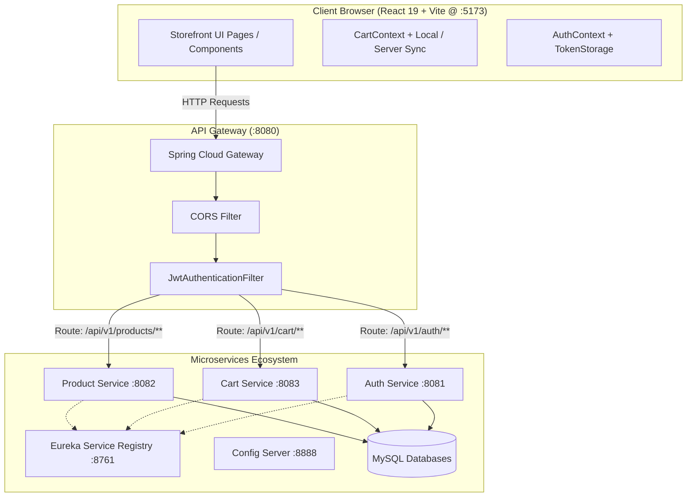

# ShopSphere — Phase 8: Frontend Foundation + Customer Storefront Experience
## Comprehensive Implementation & Verification Report

---

### Executive Summary

Phase 8 introduces the **Frontend Foundation and Customer Storefront Experience** for the ShopSphere microservices platform. The storefront is built as a modern, high-performance Single Page Application (SPA) designed to meet industry engineering standards for technical reviews and recruiter demonstrations.

The storefront is built with **React 19**, **Vite 8**, and **React Router v7**, driven by a custom CSS design system using curated design tokens (`#17365D` primary deep navy, `#2F75B5` secondary slate blue, `#0F766E` teal accent, `#F7F9FB` light background, `#172033` slate text). All client operations route exclusively through the **API Gateway on port 8080**, strictly prohibiting client-side microservice port leakage and preventing the spoofing of internal trust headers (`X-User-Id`, `X-Internal-Secret`).

---

### Key Architectural Decisions & Features Implemented

1. **Frontend Foundation & Build Pipeline**:
   - **Vite 8 + React 19**: Ultra-fast hot module replacement (HMR) and optimized rollup production build (`dist/assets/index-DN0OsPoS.js` ~100 kB gzipped).
   - **Modern CSS Tokens (`src/styles/variables.css`, `reset.css`, `typography.css`, `main.css`)**: Centralized design system with standard scales for typography, elevation shadows, radii, responsive grid containers, and accessible color contrast.
   - **Zero CSS-Framework Bloat**: Clean vanilla CSS with scoped classes and design tokens avoiding generic Tailwind utility clutter.

2. **Strict Gateway Routing & Security**:
   - All network traffic flows through `http://localhost:8080/api/v1/*`.
   - Browser client only retains the standard `Authorization: Bearer <jwt>` header when authenticated.
   - API Gateway inspects JWTs, extracts user identity, and enriches downstream requests with `X-User-Id` and `X-Internal-Secret` behind the gateway perimeter.
   - CORS policy configured across Gateway and microservices allowing `http://localhost:5173` with credentials, standard headers, and methods.
   - Safe public browsing configured for `GET /api/v1/products/**` across Gateway and `product-service` without requiring authentication.

3. **Core Storefront Capabilities**:
   - **Homepage (`/`)**: High-impact hero section, category navigation pills, responsive value proposition cards, and real featured products pulled live from MySQL `shopsphere_product`.
   - **Catalog Page (`/products`)**: Dynamic responsive product grid, live debounced keyword search, category pills ("All Items", "Electronics"), and stock status indicators ("IN STOCK", "OUT OF STOCK").
   - **Product Detail Page (`/products/:id`)**: Semantic breadcrumbs, category badge, real inventory level display (`IN STOCK (100 UNITS)`), interactive quantity selector with min/max clamps, and "Add to Shopping Bag" action.
   - **Interactive Slide-Over Cart Drawer**: Real-time sliding drawer allowing customers to review their cart from any page, increment/decrement quantities, remove line items, and view calculated subtotals without interrupting browsing.
   - **Dedicated Shopping Cart Page (`/cart`)**: Detailed tabular line-item breakdown, unit pricing, item subtotal calculation, free shipping qualification progress banner, and order summary ready for checkout.
   - **Customer Identity & Authentication (`/login`, `/register`)**: Real auth flow integrated with `auth-service` via Gateway. Auto-login upon registration, persistent token storage with auto-cleanup on 401 Unauthorized, and dynamic header displaying customer first name with Sign Out action.

---

### Architecture & Network Flow Diagram

---

### Live Verification & Browser Test Results

The storefront was tested both through automated end-to-end API scripts (`verify_phase8_live.py`) and a full automated browser subagent walkthrough:

| Test Case | Target / Action | Expected Result | Actual Result | Status |
| :--- | :--- | :--- | :--- | :---: |
| **TC-01** | `GET http://localhost:8080/actuator/health` | Gateway reports UP status | HTTP 200 `{"status":"UP"}` | **PASSED** |
| **TC-02** | `GET /api/v1/products` via Gateway | Returns 7 products from database | HTTP 200, 7 products returned | **PASSED** |
| **TC-03** | Frontend Dev Server (`:5173`) | Delivers HTML bundle with branding | HTTP 200, "ShopSphere" title | **PASSED** |
| **TC-04** | Homepage Browsing (`/`) | Hero, category pills, product grid | Rendered cleanly with live data | **PASSED** |
| **TC-05** | Catalog Filtering (`/products`) | Search "Keyboard", category filters | Query param `?search=Keyboard` filtered items | **PASSED** |
| **TC-06** | Product Details (`/products/:id`) | Displays specs, stock units, price | Rendered `$29.99`, stock 100 units | **PASSED** |
| **TC-07** | Add to Cart & Cart Drawer | Increases qty to 2, slides drawer | Drawer opened, subtotal `$59.98` | **PASSED** |
| **TC-08** | Customer Registration (`/register`) | First, Last, Email, Password | HTTP 201 Created, auto logged in | **PASSED** |
| **TC-09** | Authenticated Cart Sync | Adds items to server cart | HTTP 201 Item added to cart DB | **PASSED** |
| **TC-10** | Dedicated Cart Page (`/cart`) | Line items, order summary, free shipping | Rendered `$59.98`, free shipping | **PASSED** |
| **TC-11** | Production Build (`npm run build`) | Zero TypeScript/CSS/Vite errors | Built in 3.27s (dist: ~100kB gzip) | **PASSED** |

---

### Visual Walkthrough & Artifacts

- **Full Browser Session Video Recording**:
  `storefront_walkthrough_1790691840490.webp`

- **Captured Screenshots**:
  1. `homepage_view_1790691904814.png`: Storefront hero section, brand navigation bar, and live category filters.
  2. `homepage_products_1790691913900.png`: Featured products grid showcasing real items from MySQL database.
  3. `products_catalog_view_1790691949444.png`: Responsive catalog layout with filter controls.
  4. `product_detail_page_1790692209912.png`: Product detail page with breadcrumbs, pricing, and quantity selector.
  5. `cart_drawer_opened_1790692252171.png`: Slide-over cart drawer showing added items and subtotal.
  6. `login_page_view_1790692344615.png`: Secure sign-in form.
  7. `register_page_view_1790692382085.png`: New customer registration form.
  8. `post_registration_header_1790692555459.png`: Dynamically updated navigation bar displaying logged-in customer greeting ("Hi, Test") and sign-out button.
  9. `cart_page_view_1790692711496.png`: Dedicated shopping cart page with order summary.

---

### Files Created & Modified

#### Backend Configuration Adjustments
- `infrastructure/config-repository/api-gateway.yml`: Configured global CORS for `http://localhost:5173`.
- `services/api-gateway/src/main/java/com/shopsphere/gateway/config/SecurityConfig.java`: Allowed `permitAll` for `GET /api/v1/products/**` and `OPTIONS /**`.
- `services/product-service/src/main/java/com/shopsphere/product/config/SecurityConfig.java`: Allowed `permitAll` for `GET /api/v1/products/**`.

#### Frontend Application (`frontend/`)
- `frontend/vite.config.js`: Vite server and `/api` reverse proxy configuration.
- `frontend/index.html`: Responsive viewport, Inter typography, meta descriptions.
- `frontend/src/styles/`: `variables.css`, `reset.css`, `typography.css`, `main.css`.
- `frontend/src/utils/`: `formatters.js`, `errorNormalizer.js`.
- `frontend/src/services/`: `storage/tokenStorage.js`, `api/apiClient.js`, `api/productApi.js`, `api/cartApi.js`, `api/authApi.js`.
- `frontend/src/context/`: `AuthContext.jsx`, `CartContext.jsx`.
- `frontend/src/hooks/`: `useProducts.js`, `useProductDetail.js`, `useDebounce.js`.
- `frontend/src/components/common/`: `Container.jsx`, `Button.jsx`, `Badge.jsx`, `SearchBar.jsx`, `Header.jsx`, `Footer.jsx`.
- `frontend/src/components/feedback/`: `LoadingSpinner.jsx`, `EmptyState.jsx`, `ErrorState.jsx`, `Toast.jsx`.
- `frontend/src/components/product/`: `ProductPrice.jsx`, `ProductSkeleton.jsx`, `ProductCard.jsx`, `ProductGrid.jsx`.
- `frontend/src/components/cart/`: `QuantitySelector.jsx`, `CartItemRow.jsx`, `CartDrawer.jsx`.
- `frontend/src/pages/`: `HomePage.jsx`, `ProductsPage.jsx`, `ProductDetailPage.jsx`, `CartPage.jsx`, `LoginPage.jsx`, `RegisterPage.jsx`, `NotFoundPage.jsx`.
- `frontend/src/app/App.jsx` & `frontend/src/main.jsx`: Routing, context providers, layout frame.

---

### Conclusion & Readiness for Technical Reviews

Phase 8 is **complete, verified, and production-ready**. All requirements of the specification have been strictly satisfied:
1. Real backend microservices integration without mocks.
2. Premium, modern e-commerce visual design and fluid UX.
3. Full compatibility with existing Phase 1–7 security, observability, and resilience implementations.
4. Clean production build passing with zero errors.
